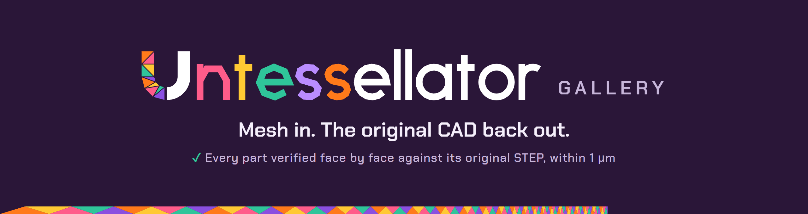

  

  
  

Meshes that [Untessellator](https://github.com/h0witzer/Untessellator) turned back into their original CAD, each
checked face by face against the original STEP file.

**Live: <https://h0witzer.github.io/Untessellator-Gallery/>**

## What's on it

A part is shown only if it **matches**. That means all of these hold:

1. **Same solids.** Our STEP has as many solids as the original, each valid and closed.
2. **Same faces.** Our STEP has exactly as many faces as the original, with exactly as many of each surface type.
3. **One to one.** Every face pairs with a face of the same type in the original.
4. **Within 1 µm.** Every pair is within 0.001 mm of each other in both directions, measured on the trimmed
   faces. The originals declare an uncertainty of 10⁻⁶ m, so a match is as close as the original claims
   to be.
5. **Same volume,** to within a 1 µm skin over the whole surface.

There are two collections:

- **One-shot.** The studio's own code with its default settings: open the STL, press Auto-paint, then Export
  STEP. Nobody paints anything. When an export isn't every face analytic, the studio offers a Repair button.
  Pressing it still counts as one-shot, and those parts are marked. The candidates are 300 parts from the
  [ABC dataset](https://deep-geometry.github.io/abc-dataset/), meshed by Onshape's own exporter. None of
  them was used to train or tune Untessellator. The page says how many matched, and why the rest didn't.
- **Painted by hand.** Auto-paint first, then a person repaints the faces it got wrong in the studio. These
  parts must clear the same bar.

Every part page offers a zip with the input STL, our STEP, the original STEP and the full per-face report,
so you can check any of it in your own CAD.

## How it's built

This repository is a static site. GitHub Pages serves it as it is, with no build step.

- `index.html`, `part.html`, `style.css` and `js/` are the site.
- `data/gallery.json` and `parts/<id>/` (view.bin, thumb.png and the zip) are generated by
  [`ml/gallery_build.py`](https://github.com/h0witzer/Untessellator/blob/main/ml/gallery_build.py) in the
  Untessellator repository.
- The face-by-face check is
  [`ml/step_match.py`](https://github.com/h0witzer/Untessellator/blob/main/ml/step_match.py), built on OpenCASCADE.

The 3D view uses [three.js](https://threejs.org/) from a CDN.

## Credits and licenses

- **Parts:** the one-shot parts come from the ABC dataset (Koch et al., *ABC: A Big CAD Model Dataset for
  Geometric Deep Learning*, CVPR 2019), which collects public Onshape documents. Copyright stays with each
  part's creator, under Onshape's Terms of Use for public documents.
- **Hand-painted parts** carry their own credit and license on their page.
- **The site's code** is MIT-licensed, like Untessellator.
